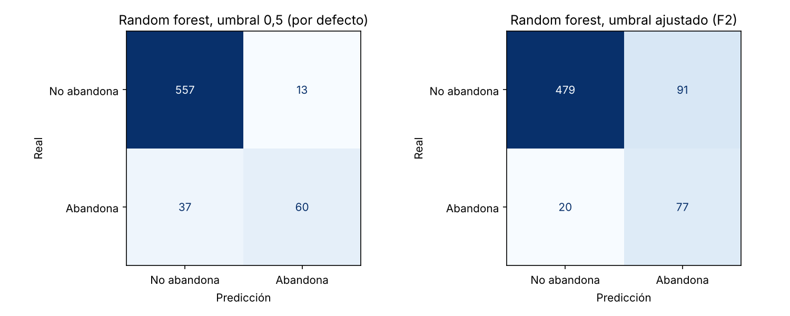

# Predicción de abandono de clientes (churn) en telecomunicaciones

> **English summary.** Churn prediction on a telecom dataset of 3,333 customers (14.5 % churn). A random forest reaches a cross-validated PR-AUC of 0.82 against 0.145 for a no-skill baseline, and on the held-out test set detects 60 of 97 churners with 13 false alarms. The project also tunes the decision threshold for recall and translates the result into the net benefit of a retention campaign under explicit assumptions, showing that the recall-oriented threshold is not the most profitable one unless the retention offer succeeds often.

## Qué resuelve

Una empresa de telecomunicaciones quiere saber a qué clientes contactar con una oferta de retención antes de que se vayan. El proyecto estima la probabilidad de abandono de cada cliente y evalúa si usar ese modelo en una campaña valdría la pena.

## Resultados

**Validación cruzada estratificada (5 particiones, sobre el 80 % de entrenamiento):**

| Modelo | Accuracy | Precision | Recall | ROC-AUC | PR-AUC |
|---|---|---|---|---|---|
| Modelo base (predice "nadie abandona") | 0,855 ± 0,001 | 0 | 0 | 0,500 | 0,145 |
| Regresión logística | 0,858 ± 0,003 | 0,534 ± 0,026 | 0,184 ± 0,048 | 0,814 ± 0,008 | 0,450 ± 0,025 |
| Random forest | 0,936 ± 0,004 | 0,895 ± 0,022 | 0,635 ± 0,036 | 0,913 ± 0,009 | 0,819 ± 0,012 |

El accuracy no sirve para comparar: el modelo base logra 0,855 sin detectar un solo abandono.

**Conjunto de prueba (667 clientes, 97 con churn), random forest:**

| Umbral | Abandonos detectados | Falsas alarmas | Precision | Recall |
|---|---|---|---|---|
| 0,5 (por defecto) | 60 de 97 | 13 | 0,822 | 0,619 |
| 0,149 (ajustado para priorizar recall) | 77 de 97 | 91 | 0,458 | 0,794 |

En prueba el random forest obtiene ROC-AUC 0,865 y PR-AUC 0,744, por debajo de la validación cruzada. Con 97 casos positivos la estimación es ruidosa, pero indica que las cifras de validación cruzada son algo optimistas.



**Traducción a negocio (con supuestos, no con datos de la empresa).** Suponiendo que un cliente retenido vale 12 cargos mensuales, que la oferta cuesta un cargo mensual por cliente contactado y que retiene al 30 % de quienes iban a irse:

| Estrategia sobre los 667 clientes de prueba | Clientes contactados | Beneficio neto |
|---|---|---|
| Sin campaña | 0 | 0 |
| Contactar a todos | 667 | −17.894 |
| Random forest, umbral 0,5 | 73 | 8.052 |
| Random forest, umbral ajustado | 168 | 6.149 |

El umbral orientado a recall detecta más abandonos pero no es el más rentable con estos supuestos; pasa a serlo solo si la oferta retiene cerca del 50 % de los casos. Con una tasa de éxito del 10 % ninguna estrategia es rentable. El umbral debería fijarse con el costo y la tasa de éxito reales de la oferta.

## Cómo reproducirlo

1. Descarga `telecom_churn.csv` desde Kaggle ([Customer Churn](https://www.kaggle.com/datasets/barun2104/telecom-churn)) y guárdalo en `data/`.
2. Ejecuta:

```bash
pip install -r requirements.txt
python scripts/check_data.py
jupyter nbconvert --to notebook --execute --inplace notebooks/01_eda.ipynb notebooks/02_validacion_y_negocio.ipynb
```

Probado con Python 3.13.

## Datos

3.333 clientes y 11 variables numéricas: `Churn` (variable objetivo), `AccountWeeks`, `ContractRenewal`, `DataPlan`, `DataUsage`, `CustServCalls`, `DayMins`, `DayCalls`, `MonthlyCharge`, `OverageFee` y `RoamMins`. No tiene valores nulos. El archivo no se versiona en este repositorio.

## Estructura

```
data/                              aquí va telecom_churn.csv (no versionado)
figures/                           gráficos generados por el notebook 02
notebooks/
  01_eda.ipynb                     análisis exploratorio y primeros modelos
  02_validacion_y_negocio.ipynb    modelo base, validación cruzada, umbral y negocio
scripts/
  check_data.py                    verifica que el dataset esté y tenga la forma esperada
requirements.txt
```

## Limitaciones

- Los valores de negocio son supuestos. El orden entre estrategias cambia con la tasa de éxito y el costo de la oferta.
- El conjunto de prueba tiene solo 97 abandonos, por lo que sus métricas tienen un margen de error amplio.
- No se ajustaron hiperparámetros, no se probaron otros algoritmos y no se calibraron las probabilidades.
- El dataset no tiene fechas: no se puede validar el modelo sobre un periodo posterior, que es como se usaría en la práctica.

## Stack

Python, pandas, scikit-learn, matplotlib y seaborn.
